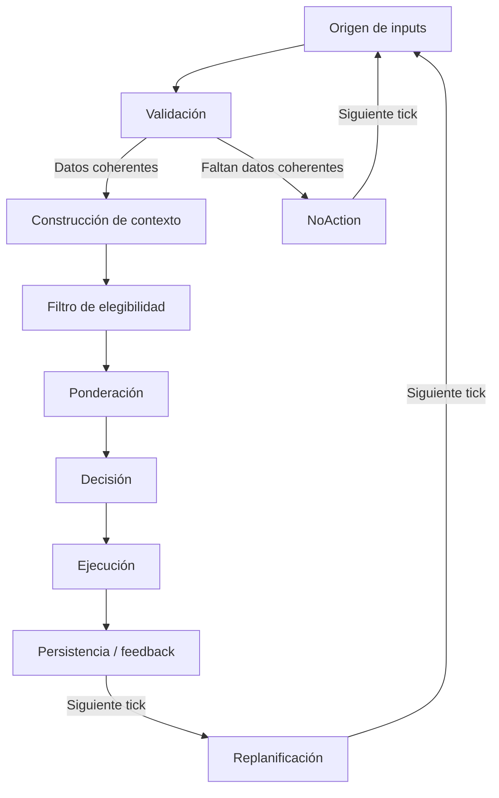

# Modo Realistic — estado y diseño

Documento **vigente** del modo Realistic (2026-10). Reemplaza el diseño inicial que vivía en `Agent Prompts/prompt1.md`: ese archivo quedó **reemplazado por este documento** y no debe usarse como fuente (está sin versionar/ignorado; conservar solo como antecedente histórico, no como especificación).

Estado conjunto: el WIP original quedó committeado como `031a9e7` (branch `dev`); la estabilización de 2026-10-14 está aplicada en el árbol de trabajo y committeada, y las correcciones de telemetría y estabilización de fase de **2026-10-15** (detalladas abajo) quedaron committeadas en `dev` con el resto del working tree.

## Interfaz de preparación y sesión (2026-10-17)

El front de Realistic usa ahora tres pasos: (1) selección/registro de aeronave, (2) resumen y sesiones, (3) pantalla única de preparación y monitoreo. Esta sección describe **solo lo implementado en UI y validación de registro**; el motor y los datos vigentes se describen más abajo. El diseño futuro de la experiencia está en `diseno-objetivo.md` §14.

- **Aeronave**: tarjetas con matrícula, tipo, horas, vuelos, promedio simple del desgaste registrado por sistema o «Sin datos», y marca de sesión sin finalizar. `UserAircraftService.GetAllAsync` carga relaciones de desgaste y sistema. El formulario limita matrícula a 10 caracteres y ofrece un selector A319/A320/A321; `CreateAsync` valida el tipo y normaliza matrícula (`Trim` + mayúsculas) también en el servicio. No se cambió el esquema ni se crean/acumulan registros de desgaste nuevos.
- **Resumen**: permanecen las estadísticas, barras de desgaste e historial expandible. Se muestra «OFP: No registrado» para todas las sesiones actuales porque `FlightSessionDto` todavía no guarda OFP; no se presentan rutas inventadas ni se ofrece todavía finalizar una sesión anterior desde su tarjeta.
- **Preparación/monitoreo**: pantalla compartida con aeronave clicable para consultar desgaste y cabecera de perfil/estado. La fase y las conexiones se consultan en la barra de estado global, no se duplican en otra tarjeta; los requisitos sí indican SimConnect/Fenix/datos de aeronave/OFP/perfil. Dos tarjetas en paralelo muestran OFP/ruta y requisitos de forma compacta. El contenido central se desplaza sin barra nativa visible. Las fallas del feed indican «Enviada (sin confirmación)»; el ojo del pensamiento, plegado por defecto y sin datos ficticios, solo aparece durante sesión activa.
- **Selección de perfil**: el botón dentro de requisitos abre `RealisticRiskProfileWindow`, ventana modal oscura con cuatro perfiles expandibles y público «Ideal para pilotos que…». Cada uno separa diseño objetivo de comportamiento del motor actual; 7700 solo se consulta y no se puede seleccionar. Bajo/Moderado/Alto se preseleccionan según la elección previa; Cancelar la conserva y Confirmar aplica el perfil elegido. El cambio se bloquea mientras haya sesión activa.
- **Acciones disponibles y bloqueadas**: «Descargar OFP» y «Pausar fallas» se muestran deshabilitados con explicación. `OfpValidated` permanece en `false`: **una sesión nueva no puede activarse desde esta UI hasta implementar la descarga y validación real del OFP**. La confirmación VATSIM está cableada después de validar requisitos y antes de iniciar, pero **no se puede alcanzar todavía**; explica que prevalece el controlador, que pausar fallas sería la acción apropiada cuando se implemente y que hoy debe detenerse y comprobarse el desarme en Fenix. Si el modo ya estaba activo, «Detener» sigue disponible; pide confirmación inline en vuelo y protege contra doble invocación mientras procesa. Se recomienda terminar en tierra, pero puede detenerse en vuelo. «Reanudar evaluación» conserva la semántica antigua tras pausa por desconexión; **no** desarma/rearma fallas. El botón «Detener» invoca el reset existente sin garantía de limpieza completa en Fenix real. La UI no agrega sonidos ni notificaciones de fallas al feed izquierdo.
- **Pendiente de integración**: descarga/revisión/validez UTC del OFP y su persistencia; arranque sin Fenix y sin restricción de fase; los cuatro perfiles completos con topes/cadencias/temporales; estados de falla confirmada y resolución; pensamiento real del motor; pausa/desarme/restauración; resultados y recuperación de sesiones abiertas. Los tres perfiles seleccionables describen **solo el motor vigente** (tope global 3 y cooldown 60 s), no los topes objetivo de `diseno-objetivo.md` §5.
- **Verificación**: la compilación Debug y las pruebas de unidad automatizadas se consignan en `docs/CHANGELOG.md`. La app DEBUG arrancó desde la carpeta del proyecto y se navegó por automatización a Realista/paso 1; no se comprobó el paso 3 ni el modal porque no había aeronaves registradas. No se ha verificado visualmente la ventana a tamaño mínimo ni se ha ensayado esta UI en una sesión real MSFS/Fenix.

## Fase 1 — Fundamentos del esquema objetivo (2026-10-17)

Primera fase del backend del modo Realistic: configuración, esquema (migración `RealisticModeFlowSchema`) y catálogo de sistemas. La severidad por falla se completó el **2026-10-17** con el campo `severity` en las 384 fallas de `failures.json` (ver sección «Severidad de fallas del catálogo»); la **persistencia** del campo en `FenixFailureDefinition` sigue pendiente.

- **Configuración** — nueva sección `FailureEngine:RealisticMode` en `FailureEngineSettings` y `appsettings.json`: `EvaluationIntervalSeconds=30`, `PreparedQueueLimit=5`, `GroundFailureEnabled`, `ThinkingLinesCap=50`, `Ofp{PreStartWindowHours=2, PostArrivalWindowHours=2}`, `Wear{AmplificationFactor=0.5, ThresholdNoticePct=80}`. Sin cadencias de disparo nuevas (calibración pendiente; los topes actuales del motor son los vigentes).
- **Esquema** — creado con `EnsureCreatedAsync()` desde el modelo (desarrollo; no hay migraciones; política en `docs/desarrollo.md`):
  - `FlightPlans` (tabla nueva): origen/destino/aerotipo, número/vuelo y callsign, offblock y aterrizaje estimado en UTC, duración, ruta, XML crudo, fuente (`Userid`/`Url`), fechas de descarga/validez, `ValidationState` y mensaje. `FlightSession` gana `FlightPlanId` (FK Restrict), `OriginIcao`, `DestinationIcao` y `ResultSnapshotJson`.
  - `TriggeredFailure` gana el ciclo de vida: `State` (default `Sent`), `FenixConfirmedAtUtc`, `ResolvedAtUtc`, `ResolvedPhase`, `ResolutionSource`, `CanBeTemporary`, `PreparedAtUtc`.
  - `FenixFailureSystem.AtaId` y `AircraftWearableSystem.AtaId` (join 1:1 por ATA) y `FenixFailureDefinition.CanBeTemporary`.
  - **Seed de sistemas ampliado de 8 a 19**, alineado a los 19 bloques ATA de `failures.json` (21..80): los Ids 1-8 se re-semantizan (antes Engine 1/2, HYD, GEAR, NAV, PNEU, APU, DOOR) y ya no existe "Engine 1/Engine 2" como sistemas independientes; se fusionan en ATA 70 (Power plant) y ATA 80 (Start faults). **Impacto**: datos de `AircraftSystemWear` de aeronaves existentes que apunten a Ids 1-8 quedan asociados a un sistema de distinto nombre; en la base real no había aeronaves con desgaste persistido al momento del cambio.
- **Enums aditivos** — `FailureLifecycleState` (Preparing/Queued/Sent/Active/ResolvedByPilot/AutoResolved/NotResolved/Rejected), `ResolutionSource` (EngineAuto/Pilot/SessionEnded), `ValidationState` (Pending/Valid/Invalid/Expired) y `SessionEventCategory` ampliado (Pause, ResumeOrReconnect, FailureStateChanged, WearUpdated, OfpLoaded, SessionRecovered = 9..14). Sin esquema.
- **Verificación** — esquema validado con `EnsureCreated()` sobre SQLite en memoria y en DB temporal de archivo (19 sistemas con AtaId 21..80, tabla `FlightPlans`, defaults del ciclo de vida); se borraron las bases locales y se eliminaron las migraciones previas (consolidación dev, 2026-10-17). Build Release sin advertencias y **88/88 tests** (3 nuevos: seed 19/AtaId, valores aditivos de `SessionEventCategory`, defaults de `RealisticMode`). El roundtrip a DB del ciclo de vida de `TriggeredFailure` quedó validado por el esquema; su prueba unitaria de entidad se deja para la fase de estados de falla.

## Implementado (verificado en código)

- **`RealisticSessionManager`** (`RealFenixFailures.Application/Services/RealisticSessionManager.cs`) — singleton; **responsable del ciclo de vida y el timer**: `StartNewSessionAsync`, `StopAsync`, `PauseAsync`, `ResumeAsync`; `PeriodicTimer` de evaluación de **30 s** (`EvaluationIntervalSeconds`); despacha `FailureTriggered` y `SessionError` hacia la UI.
- **`RealisticSessionEngine`** (`RealFenixFailures.Application/Session/RealisticSessionEngine.cs`) — nueva instancia por sesión; **responsable de la evaluación**: `TryStartSession` (valida conexión Fenix+SimConnect y avión en gate con motores apagados), `EvaluateAsync` por tick, `TryTriggerFailureAsync`.
- **Reanudación manual desde la UI**: `RealisticModeViewModel` expone `IsSessionPaused` y `ResumeSessionCommand` (invoca `IRealisticSessionManager.ResumeAsync(CancellationToken.None)`, suscrito a su `PropertyChanged`); `RealisticModePanel.xaml` muestra el botón **"REANUDAR SESIÓN"** junto a la acción de detener, visible solo cuando la sesión está pausada. No hay auto-resume.
- **`RealisticSession`** (`RealFenixFailures.Application/Session/RealisticSession.cs`) — estado mutado por el engine: fase actual, datos del sim, fallas Fenix armadas/falladas, `LastTriggeredAtUtc`, presets disponibles, `ActiveFailureCount`.
- **`FlightEventDetector`** (singleton, transversal) — clasifica fase y eventos; fuente única de fase.
- **Persistencia del WIP**: `IFlightSessionService` crea/cierra sesión (`FlightSession` con `RiskLevel` y `UserAircraftId`), registra `TriggeredFailure` por falla disparada y persiste además **`SessionEventLog` append-only** durante las sesiones Realistic: `SESSION_STARTED`, `SESSION_STOPPED`, eventos de motores, cambios de fase, cruces de altitud y fallas disparadas (detalle en la sección "Historial de sesiones y totales derivados (2026-10-15)").
- **Provisión de presets realistas (seed)** — `PresetService.InitializeAsync` siembra por tipo de forma **condicional e independiente**: si no existe ningún preset `TrainingMode`, carga `training_presets.json` (embedded resource) vía `IPresetsLoader.GetTrainingPresetsAsync` y los inserta; después hace el mismo chequeo para `RealisticMode` con `realistic_presets.json` (`GetRealisticPresetsAsync`). La secuencia es siempre primero Training y luego Realistic; por tipo es idempotente (si ya existe alguno, no recarga ni reinserta). El catálogo realista (44 presets) queda en la base como candidatos y la sesión Realistic los consume desde el repositorio (`GetRealisticPresetsAsync` lee de la DB).
- **Arranque desde UI**: `EngineOrchestrator.StartRealisticModeAsync` → manager; requiere conexión previa.
- **Mock de SimConnect** en DEBUG (vuelo sintético de 5 min) y **mock de Fenix** en DEBUG.

### Constantes verificadas

| Constante | Valor | Lugar |
|---|---|---|
| Probabilidad base por tick | `BaseProbability = 0.10` | `RealisticSessionEngine` |
| Cooldown entre fallas | `MinCooldownSeconds = 60` | `RealisticSessionEngine` |
| Máx. fallas simultáneas | `MaxSimultaneousActiveFailures = 3` | `RealisticSessionEngine` |
| Multiplicador Low | 0.5 | `RiskProbabilityMultiplier` |
| Multiplicador Moderate | 1.0 | `RiskProbabilityMultiplier` |
| Multiplicador High | 1.75 | `RiskProbabilityMultiplier` |
| Intervalo de evaluación | 30 s | `RealisticSessionManager` |

Significado de `Probability` por definición (realistic): **peso relativo de selección** entre las fallas elegibles del preset; `FailureTrigger.TryTriggerFailure` elige por acumulación ponderada sobre la suma de pesos (`totalWeight`). No es la probabilidad de disparo de la sesión: esa es `BaseProbability` (0.10) × multiplicador de riesgo, aplicada por preset candidato en cada tick; el multiplicador de riesgo no modifica los `Probability` individuales.

`Difficulty` es metadato de clasificación (Easy=1, Medium=2, Hard=3, Insane=4); no está conectado al filtro de riesgo del modo Realistic (el filtro opera por severidad de la falla Fenix en `FailureRuleEvaluator`, no por `Difficulty` del preset).

Regla de severidad (`FailureRuleEvaluator`): Low → solo `Minor`; Moderate → `Minor`/`Major`; High → todas.

## Estabilización verificada (2026-10-14)

Correcciones aplicadas sobre el WIP (`031a9e7`) y **verificadas por build y tests** (aun **no committeadas**). Referencias con ruta/símbolo.

- **Validación antes de persistir sesión** — `RealisticSessionEngine.TryStartSession` (`Application/Session/RealisticSessionEngine.cs`) valida conexión y condiciones (gate con motores apagados) y solo después crea la `FlightSession`; si el inicio falla, `RealisticSessionManager.StartNewSessionAsync` descarta el scope y deja `SessionState == null` (sin estado residual).
- **Presets antes de persistir la sesión (sesión huérfana resuelta)** — `TryStartSession` carga `GetRealisticPresetsAsync` ANTES de `StartNewAsync` y asigna esa lista ya cargada a `Session.AvailablePresets`; si la carga de presets lanza, `StartNewAsync` no se llama y `Session` queda `null` (no queda sesión persistida huérfana).
- **Fallo fatal de evaluación sin estado activo residual** — `EvaluateAndExecuteAsync` devuelve una señal para que `RunEvaluationLoopAsync` termine; al salir por fallo fatal, el manager limpia engine/scope/timer/cts, deja `IsPaused=false` y notifica `SessionError`. El cierre se ejecuta dentro de la task del loop sin auto-esperarse (no invoca `StopAsync`/`StopLoopAsync`, que esperarían `_evaluationLoopTask`); un `OperationCanceledException` o la desconexión no se tratan como fallo fatal (la desconexión sigue siendo pausa reanudable).
- **Compensación distingue cancelación** — en `TryTriggerFailureAsync`, si `AddTriggeredFailureAsync` arroja `OperationCanceledException` se loguea distinto y se intenta **igual el desarme** (con `CancellationToken.None`) antes de propagar la cancelación; el resto de errores de persistencia mantienen la compensación existente.
- **Documentación de desarme sin campo `armed`** — [integraciones/fenix-api.md](../integraciones/fenix-api.md) ya no menciona un campo inexistente; la semántica real es `(Failed=false, Condition=null)` (una falla está armada cuando `FailureCondition != null` o `Failed == true`).
- **Null safety** — `TryStartSession` y la obtención de datos de sim comprueban `IsSuccess` y null antes de usar el valor (no hay accesos `Value!` sin verificar).
- **Scope por sesión** — `RealisticSessionManager` (singleton) crea un `IServiceScope` por sesión (`IServiceScopeFactory.CreateScope()`) y resuelve de ahí `IFlightSessionService`/`IPresetService`/`IFailureTrigger`; el scope se descarta en `StopAsync`. Ya no captura el servicio scoped en el ctor.
- **Pausa/reanudación idempotentes** — `PauseAsync`/`ResumeAsync` no actúan si el estado no cambia; `StopLoopAsync` cancela el `PeriodicTimer` y **espera** la tarea del loop antes de cerrar la sesión.
- **Detector thread-safe** — `FlightEventDetector` (`Application/Services/FlightEventDetector.cs`): estado mutable protegido con `lock (_sync)` en `ProcessSnapshot`, `Reset` y propiedades.
- **Landing alcanzable** — `DeterminePhase` devuelve `ComplexFlightPhaseEnum.Landing` al aterrizar desde una fase aérea y el evento de aterrizaje se emite.
- **StopFlightSimulation garantizado** — `EngineOrchestrator.StopCurrentModeAsync` invoca `IFlightSimulationController.StopFlightSimulation` en el bloque `finally` para cualquier modo (antes solo se llamaba al iniciar).
- **finishedAt respetado** — `FlightSessionService.StopAsync(sessionId, finishedAt, ct)` persiste ese `FinishedAt`; `RealisticSessionEngine.StopSession` cierra la sesión con `DateTime.UtcNow`.
- **Compensación de persistencia** — `RealisticSessionEngine.TryTriggerFailureAsync`: si `AddTriggeredFailureAsync` falla tras armar la falla, se intenta el **desarme individual** (`ISimulatorConnectionService.DisarmFailureAsync`); si ambos fallan, loguea `Critical` (la falla queda armada sin registrar). Detalle en [integraciones/fenix-api.md](../integraciones/fenix-api.md).
- **Feed de logs acotado** — `MainWindowViewModel.FlightEventDetector_FlightEventDetected` inserta en `LogEntries` vía `Dispatcher.InvokeAsync` y recorta el excedente sobre `MaxLogEntries = 200` (FIFO).
- **Warnings, arquitectura y paquetes** — nulabilidad, `ExecutionEngineException` obsoleta y variables sin uso corregidas; `PlatformTarget=x64` en UI, TestUnits e Integrations.SimConnect (resuelve MSB3270); dependencias actualizadas (resuelve NU1903).

**Verificación (2026-10-14)**

- `dotnet build RealFenixFailures.slnx -c Debug --no-restore`: 0 errores, 0 advertencias.
- `dotnet build RealFenixFailures.slnx -c Release --no-restore`: 0 errores, 0 advertencias.
- `dotnet test RealFenixFailures.TestUnits/RealFenixFailures.TestUnits.csproj --no-restore`: **34/34** (se suman los focalizados de esta revisión: presets-huérfanos, cierre fatal del manager, pausa por desconexión reanudable y compensación por cancelación).
- `dotnet list RealFenixFailures.slnx package --vulnerable --include-transitive`: ningún paquete vulnerable.
- Integración real MSFS/Fenix: **no verificada**.

## Estabilización de telemetría y fase (2026-10-15)

Correcciones aplicadas y **verificadas por build y tests** (49/49) en `dev`. Referencias con ruta/símbolo.

- **SimVars correctos para altitud y velocidad indicada** — el cliente real (`RealFenixFailures.Integrations.SimConnect/Services/SimConnectClient.cs`) solicita ahora `PLANE ALTITUDE` (altitud de la aeronave en pies, mapeada a `AltitudeMSL`) en lugar de `PRESSURE ALTITUDE`, y agrega `AIRSPEED INDICATED` (knots, FLOAT64) como telemetría adicional; el campo del struct se renombra a `PlaneAltitude` y `AirspeedIndicated` se propaga a `SimConnectAircraftState`, `SimulatorAircraftStateSnapshot`, clones, provider y logs de diagnóstico. El orden del struct y de `AddToDataDefinition` se mantiene sincronizado. **No** se usan `L:Vars` ni se captura combustible (sin base).
- **Redondeo solo en la representación de diagnóstico** — `SimulatorFlightDataProvider.GetAircraftRawData` redondea lat/lon a 5 decimales y N1/throttle a 1 decimal en el log de diagnóstico; los valores internos conservan su precisión (no se redondean/alteran arbitrariamente).
- **Flag `HasSimulatorData`** — `SimulatorAircraftStateSnapshot.HasSimulatorData` (default `false`, `init`, copiado en `Clone`) lo marca `SimulatorFlightDataProvider` desde `SimConnectAircraftState.IsConnected`. `SimConnectClient` limpia el último estado a `new()` y `_lastDataReceivedUtc = DateTime.MinValue` bajo el lock al iniciar una nueva conexión, al desconectar y al recibir Quit, para que no sobreviva una muestra obsoleta a la reconexión.
- **Detector sin datos** — `FlightEventDetector.ProcessSnapshot` con `HasSimulatorData=false` no procesa transiciones/eventos/altitud, limpia todo el tracking anterior (fase confirmada, debounce, altitud y motor/latch) y devuelve `Unknown`, sin emitir eventos; así una lectura corrupta o la ausencia de avión nunca dejan `Landing`/`Cruise` estancadas. (Antes conservaba la fase confirmada; ver "Detección de datos de aeronave coherentes y DuplicateID 29" más abajo, que corrige ese comportamiento.)
- **Bandas VS simétricas** — `DeterminePhase`: debajo de 5000 ft AGL, `VS>200` Climb, `VS<-200` Approach, resto Cruise; a/por encima de 5000 ft AGL, `VS>200` Climb, `VS<-200` Descent, resto Cruise (antes la banda `|VS| 100..200` por encima de 5000 clasificaba ascenso suave como Descent).
- **Debounce temporal por `ObservedAt`** — transiciones aéreas (Climb/Cruise/Descent/Approach) requieren lecturas consistentes: Cruise 60 s, Descent 45 s, Climb/Approach 10 s. La primera fase conocida se acepta al instante; las fases de tierra y Landing se aplican inmediatamente; dos candidatos distintos limpian/reinician el tiempo; al perder datos se borra el candidato. La cadencia de evaluación (5 s general / 30 s Realistic) no cambia: en modo 30 s la confirmación cae en el tick que supera el límite.
- **Carrera de despegue** — estando en tierra: `throttle>80` y `GS>50` ⇒ Takeoff; `GS>5` ⇒ Taxi (antes Takeoff requiría `GS<=5` con throttle alto y era inalcanzable en carrera).
- **Latch de aterrizaje** — tras Landing, mientras `_hasLandedThisFlight` y no se observa Takeoff, una lectura aérea espuria de nivel bajo no vuelve a Cruise: se mantiene la fase terrestre confirmada. El despegue real pasa por la fase Takeoff, que limpia el latch (se conserva el texto "Taxi final hacia el gate").
- **Engine sin datos** — `RealisticSessionEngine.EvaluateAsync` con `HasSimulatorData=false` no actualiza `RealisticSession` ni intenta disparar una falla en ese tick: loguea debug y devuelve `EvaluationResult.NoAction()`.

**Verificación (2026-10-15)**

- `dotnet build RealFenixFailures.slnx -c Debug`: 0 errores, 0 advertencias.
- `dotnet test RealFenixFailures.TestUnits/RealFenixFailures.TestUnits.csproj`: **49/49** (se suman: snapshot inválido inicial y entre muestras, VS +150 >5000 no es Descent, debounce Cruise 60 s y Descent 45 s, Landing inmediata, lectura aérea tras aterrizaje sin retorno a Cruise, Takeoff alcanzable, y engine con snapshot sin datos).
- Integración real MSFS/Fenix: el usuario verificó la publicación en producción y reportó que la telemetría corregida funciona; los logs de diagnóstico muestran datos coherentes. Esta verificación es manual y no la cubren los tests automatizados.

## Detección de datos de aeronave coherentes y DuplicateID 29 (2026-10-15)

Cambio implementado, verificado por build y tests y **comprobado por el usuario en producción**; corrección del problema indicado por los logs de diagnóstico compartidos. El usuario reporta que la telemetría corregida funciona correctamente. Referencias con ruta/símbolo.

- **DuplicateID 29 en `AddToDataDefinition`** — los logs mostraban `SimConnect Exception: 29` en cada conexión junto con telemetría corrupta (`Lon=6.8e38` o `0`, `AltMSL=0`, `IndAlt≈1e-313`, `AltAGL=-2147483648`, `Flaps=2147483647`, combustión con enteros enormes, N1/throttle absurdos) y el detector marcando `Landing` con `OnGround=false`. Contrastado con la doc oficial del SDK, el enum 29 es `SIMCONNECT_EXCEPTION_DUPLICATE_ID`, que se produce por IDs repetidos usados en `AddToDataDefinition`: el cliente pasaba `0` explícito como DatumID en las 18 definiciones. `SimConnectClient.RegisterDataDefinitions` ahora asigna IDs de datum únicos (`uint datumId` con `datumId++`, 0..17) sin alterar el orden del struct; el handler `OnRecvException` enriquece el mensaje con `dwException`, `dwSendID` y `dwIndex`.
- **Validador puro de paquetes** — `AircraftStateDataValidator.IsValid` (`RealFenixFailures.Integrations.SimConnect/Models/AircraftStateDataValidator.cs`): rangos físicos razonables (posición, altitudes MSL/AGL, heading, velocidades, VS, flaps, N1, throttle), booleanos int estrictos 0/1 (`SIM ON GROUND`, combustión), rechazo de NaN/Infinity/denormales y del frame completamente en cero; permite aeronave estacionada a altitud 0 cuando posición y otros campos contienen datos coherentes. Un paquete inválido conserva sus valores crudos en `SimConnectAircraftState` para diagnóstico pero con `IsConnected=false` (y por lo tanto `HasSimulatorData=false`). El callback actualiza `_lastDataReceivedUtc` por cualquier paquete recibido (sin bucle de reconexión cuando SimConnect responde sin avión) y sobrescribe siempre el último estado, de modo que una muestra inválida nunca deja la telemetría previa válida como actual. Sin warnings por paquete (100 ms).
- **`HasAircraftData` en el estado de conexión** — `ConnectionStatusDto` (Application) gana la propiedad init-only `HasAircraftData` (default `false`; se preserva el constructor posicional). `SimulatorConnectionService.GetConnectionStatusAsync` marca `HasAircraftData` y reporta fase `Disconnected` si el handle está abierto pero no hay datos coherentes (antes `Flying`/`OnGround` con telemetría basura). Se representa por separado: handle SimConnect conectado vs telemetría coherente disponible.
- **UI** — `MainWindowViewModel` sincroniza `HasAircraftData`; `SimConnectStatus` distingue `Disconnected`, `Connected · No aircraft data` y `Connected · Aircraft data` con punto gris/ámbar/verde (los bindings XAML existentes no cambian); `CanStartEngine` exige SimConnect + datos de aeronave + Fenix; `CurrentFlightPhaseDisplay` muestra `Disconnected`/`No aircraft data` sin presentar fases viejas. `RealisticModeViewModel` sincroniza la propiedad, exige `HasAircraftData` en `CanActivate`, agrega la razón "MSFS conectado pero sin datos de aeronave disponibles." cuando el handle está abierto sin telemetría y muestra `Disconnected`/`No aircraft data` en su indicador de fase.
- **Detector limpia tracking ante falta de datos** — `FlightEventDetector.ProcessSnapshot` con `HasSimulatorData=false` limpia fase, debounce, altitud y motor/latch y devuelve `Unknown` sin emitir eventos: una lectura corrupta o ausencia de avión nunca deja `Landing`/`Cruise` estancada. El motor realista ya salta ese tick (`EvaluateAsync` devuelve `NoAction` con `HasSimulatorData=false`); ese comportamiento se conserva.

**Verificación (2026-10-15 — detección de datos de aeronave y DuplicateID 29)**

- `dotnet build RealFenixFailures.slnx -c Debug`: 0 errores, 0 advertencias.
- `dotnet test RealFenixFailures.TestUnits/RealFenixFailures.TestUnits.csproj`: **69/69** (se suman: validador acepta aeronave estacionada y rechaza el frame vacío y el frame tipo log, fase `Disconnected` con handle conectado sin datos y `OnGround`/`Flying` solo con datos, detector a `Unknown` sin eventos ante snapshot inválido y sin eventos fantasma de fase al reanudar, y estado de conexión del simulador en el servicio).
- La detección de datos se describe como **datos coherentes disponibles** (validador físico), no como confirmación de un estado de menú específico del simulador; no se implementó ningún API de menú ni `L:Vars`. La telemetría de los logs posterior al cambio sigue pendiente de una nueva sesión real; builds y tests no reemplazan la prueba manual.

## Historial de sesiones y totales derivados (2026-10-15)

Cambio aplicado y verificado por builds focalizados y tests (55/55); verificación al final de la sección. Referencias con ruta/símbolo.

- **`SessionEventLog` append-only por sesión** — `IFlightSessionService` persiste la nueva entidad `SessionEventLog` (`Domain/Entities/SessionEventLog.cs`) durante las sesiones Realistic: `SESSION_STARTED` al iniciar, `SESSION_STOPPED` al cerrar (antes de `StopAsync`), eventos de motores, cambios de fase y cruces de altitud, y `FAILURE_TRIGGERED` por cada falla disparada. Cada evento guarda `OccurredAt`, categoría (`SessionEventCategory`), descripción, fase de vuelo y el `TriggeredFailureId` enlazado cuando corresponde. `EventCode` es un identificador semántico string (p. ej. `TAXI`, `LANDING`) que puede repetirse entre eventos/sesiones; la identidad de fila es `Id`.
- **Suscripción al detector solo durante la sesión activa** — `RealisticSessionEngine` (`Application/Session/RealisticSessionEngine.cs`) se suscribe a `FlightEventDetector.FlightEventDetected` al iniciar la sesión y se desuscribe al cerrarla; los eventos llegan **síncronos** a una cola `_pendingFlightEvents` (protegida con lock) y se **persisten async en cada tick** (`DrainFlightEventsAsync` dentro de `EvaluateAsync`). El `SESSION_STARTED` se registra antes de suscribirse; si su registro falla, la sesión se cierra y no queda activa.
- **Falla + evento en una unidad de trabajo** — `FlightSessionService.AddTriggeredFailureAsync` (`Application/Services/FlightSessionService.cs`) guarda el `TriggeredFailure` y su evento `FAILURE_TRIGGERED` enlazado y persiste ambos con un único `SaveChangesAsync` (atómico).
- **Snapshot histórico en `TriggeredFailure`** — la entidad (`Domain/Entities/TriggeredFailure.cs`) ahora copia al disparar el detalle completo de la condición del preset: nombre y severidad de la falla, `PresetId`/`PresetName`, `Probability`/`ProbabilityGroup`, `Ias`, altitudes (`AboveAltitude`/`BelowAltitude`), `Time` y `AfterEvent`/`AfterEventSeconds`. El historial no depende del catálogo mutable.
- **Totales de aeronave derivados** — `UserAircraft.TotalFlights` y `UserAircraft.TotalFlightHours` ya **no se almacenan** (columnas eliminadas por la migración): los DTOs (`UserAircraftService.ToDto`) los calculan desde las `FlightSessions` **finalizadas** de la aeronave (`FinishedAt != null`); las sesiones abiertas no cuentan.

**Verificación (2026-10-15 — historial y totales derivados)**

- `dotnet test RealFenixFailures.TestUnits/RealFenixFailures.TestUnits.csproj -c Debug --no-restore`: **55/55**.
- `dotnet build RealFenixFailures.slnx -c Debug --no-restore`: 0 errores, 0 advertencias.
- `dotnet build RealFenixFailures.slnx -c Release --no-restore`: 0 errores, 0 advertencias.
- La migración se aplicó sobre una base temporal y se verificaron `Up`, `Down` y una nueva aplicación de `Up`; la base real no se modificó. Sin verificación manual; las integraciones reales MSFS/Fenix siguen sin verificar (ver "Limitaciones restantes").

## En desarrollo

- Verificación manual de la integración real MSFS/Fenix (los mocks de DEBUG y los 29 tests no reemplazan la prueba real).

## Pendiente

- **`RemoveTemporaryFailuresAsync`** — eliminación de fallas temporales de emergencia (prevista en el diseño, no implementada).
- **Provisión de presets realistas — limitación del seed** — el sembrado es de una sola vía: si en la base ya existe **cualquier** preset `RealisticMode` (propio o de otra fuente), el catálogo no se mezcla ni se actualiza (no hay merge ni refresh del catálogo contra la DB). El catálogo tampoco define relación componente-desgaste (sigue pendiente).
- **Cálculo y persistencia de desgaste** — `AircraftSystemWear`/delta por vuelo, amplificación de probabilidad por desgaste (`probabilidadFinal = base × (1 + factor × wear/100)`); no implementado.
- **Incompatibilidades de fallas** — evitar fallas mutuamente excluyentes simultáneas; no implementado.
- **Configuración de constantes** — probabilidad base, cooldown, máx. simultáneas y multiplicadores están como `const` en código; se prevé moverlas a configuración.
- Completar el uso funcional del modelado de aeronaves y desgaste ya existente (`UserAircraft`, `AircraftWearableSystem`, `AircraftSystemWear`), especialmente la acumulación de **desgaste** por vuelo y su efecto sobre las probabilidades (los totales de horas/vuelos ya no son pendiente: se calculan desde las sesiones finalizadas, ver sección de 2026-10-15).
- **Auto-resume** — reanudar automáticamente la sesión tras una interrupción; no implementado.

## Decisiones abiertas

- Valores numéricos finales del factor de desgaste por nivel de riesgo.
- Mecanismo de notificación manager → UI (hoy eventos `EventHandler` + `INotifyPropertyChanged`).
- Vincular fallas Fenix ↔ sistema desgastable: FK directa vs tabla de mapeo.

## Investigación y diseño: la meta del modo Realistic y los bloques de pensamiento del engine (2026-10-16)

> **Sección de investigación/diseño, no implementada en código.** Explora cómo debería pensar el motor realista cuando el modo evolucione del sorteo ponderado actual a un proceso con narrativa propia. Todo lo de esta sección es propuesta: el comportamiento vigente es el de "Implementado" arriba y las restricciones de "Limitaciones restantes".

### Objetivo del modo realista

El modo Realistic debe producir fallas que se sientan como **consecuencia natural de la operación**, no como sorteo: el engine razona sobre contexto, estado de la aeronave, historial de la sesión, plausibilidad y objetivo para decidir *si* y *qué* falla; un piloto que mira hacia atrás debe poder decir "tenía sentido que pasara eso".

### Capas de pensamiento del engine

| Capa | Qué piensa | Qué necesita |
|---|---|---|
| Contexto de vuelo | Dónde está la aeronave y qué está haciendo: fase, altitud MSL/AGL, IAS, VS, motores, tierra/aire | Telemetría coherente del simulador (SimConnect) y fase confirmada del `FlightEventDetector` |
| Estado del avión | Qué tan sano está cada sistema y cómo se operó: desgaste, configuración, uso | Modelo de aeronave y desgaste de sistemas (hoy pendiente, ver "Pendiente") |
| Historial de sesión | Qué pasó ya en esta sesión/vuelo: fallas disparadas, cooldown, eventos | `SessionEventLog`, `TriggeredFailure` y reloj de cooldown |
| Plausibilidad | Si es creíble que falle *esto* en *este* momento: condiciones físicas, incompatibilidades, narrativa | Reglas de severidad y condiciones de los presets; incompatibilidades (pendiente) |
| Objetivo | Qué experiencia se está construyendo: tensión, aprendizaje, realismo | Perfil de riesgo del modo: **dirección, no veredicto** |

### Proceso mental del engine (flujo propuesto)



`Origen de inputs → Validación → Construcción de contexto → Filtro de elegibilidad → Ponderación → Decisión → Ejecución → Persistencia/feedback → Replanificación`

Flujo principal por fases: cada fase consume lo que produce la anterior. En la tabla, "consume" incluye tanto entradas externas como lo dejado por la fase previa, y "produce" es lo que queda para la siguiente.

| Paso | Qué hace | Consume | Produce |
|---|---|---|---|
| **1. Origen de inputs** | Reunir todo lo que llega para el tick | Telemetría, conexión Fenix + SimConnect, presets, historial de la sesión, OFP, desgaste de aeronave, preferencias del usuario | Paquete bruto de inputs del tick |
| **2. Validación** | Comprobar que hay datos mínimos coherentes y permisos para evaluar | Telemetría coherente (`HasSimulatorData`), conexión Fenix + SimConnect, presets cargados | Tick válido, o `NoAction` como salida directa (no se entra al resto del flujo) |
| **3. Construcción de contexto** | Interpretar dónde está la aeronave, qué está haciendo y si la realidad sigue el plan | Tick validado, fase confirmada del detector, historial de la sesión, OFP como planificación previa | Snapshot de contexto interpretado: fase, ventanas esperadas vs reales y estado del avión |
| **4. Filtro de elegibilidad** | Descartar lo imposible o increíble para la situación actual | Contexto, catálogo/presets, reglas de severidad y condiciones, plan de vuelo (ventanas) | Lista de candidatos elegibles para el tick |
| **5. Ponderación** | Calcular el peso final de cada candidato: plausibilidad (contexto + historial + objetivo) más `Probability` del preset | Candidatos, historial, desgaste (pendiente), objetivo/preferencias del modo | Pesos finales de selección por candidato |
| **6. Decisión** | Aplicar la probabilidad de disparo (hoy `BaseProbability` × multiplicador de riesgo) con cooldown y máx. simultáneas, y elegir por acumulación ponderada | Pesos, constantes del modo, estado de cooldown y fallas activas | Decisión del tick: **armar**, **posponer** o **no armar** |
| **7. Ejecución** | Materializar la decisión en el simulador | Decisión, API Fenix | Falla armada o desarmada en Fenix |
| **8. Persistencia/feedback** | Registrar la falla y el evento de sesión como unidad de trabajo y actualizar el estado de la sesión | Falla ejecutada, sesión activa, historial | `TriggeredFailure` + `SessionEventLog` (atómico) y estado de sesión actualizado |
| **9. Replanificación** | Cerrar el tick: qué queda descartado para la sesión y qué se vuelve plausible después | Historial actualizado, contexto del tick | Narrativa de la sesión actualizada, que vuelve a entrar al siguiente tick vía historial |

La cadena conceptual anterior (`Observar → Enmarcar → Seleccionar → Ponderar → Decidir → Actuar y registrar → Re-planificar`) se conserva como resumen: **Observar** cubre el origen de inputs y la validación; **Enmarcar** es la construcción de contexto; **Seleccionar candidatos** es el filtro de elegibilidad; **Ponderar** y **Decidir** mapean 1:1 a ponderación y decisión; **Actuar y registrar** une ejecución + persistencia; **Re-planificar** es la replanificación.

### Entradas y salidas del motor (diagrama de diseño)

**Tabla de inputs**, agrupados por categoría. La columna "Oblig." marca si el motor necesita el input para funcionar (**obligatorio**) o si solo lo enriquece cuando está disponible (opcional).

| Categoría | Input | Oblig. | Rol |
|---|---|---|---|
| Simulador | Telemetría (fase, altitud MSL/AGL, IAS, GS, VS, heading, motores, tierra/aire, N1/throttle, flaps) | **Obligatorio** | Contexto real del tick; sin datos coherentes el tick se salta (`NoAction`) |
| Simulador | Disponibilidad de datos coherentes (`HasSimulatorData`) | **Obligatorio** | Puerta de entrada de la evaluación: solo se procesa telemetría validada por rangos físicos |
| Simulador | Conexión Fenix + SimConnect | **Obligatorio** | Habilita/inhabilita evaluación y armado |
| Aeronave | Modelo de la aeronave (`UserAircraft`, sistemas asociados) | Opcional | Contexto de qué sistemas existen y su historial de uso (pendiente de conexión al motor) |
| Aeronave | Desgaste de sistemas (`AircraftSystemWear`, delta por vuelo) | Opcional | Factor de plausibilidad por sistema y amplificación de probabilidad (`base × (1 + factor × wear/100)`); pendiente de implementación |
| Aeronave | Configuración y uso en vuelo (flaps, tiempos de operación) | Opcional | Operación por sistema, hoy solo parcial vía telemetría |
| Sesión/historial | Historial de la sesión (`SessionEventLog`, `TriggeredFailure`) | **Obligatorio** | Memoria operativa: qué pasó, qué no se repite, narrativa |
| Sesión/historial | Estado de la sesión (fase actual, `ActiveFailureCount`, `LastTriggeredAtUtc`, presets disponibles) | **Obligatorio** | Estado mutado por el engine entre ticks, reentrante a cada evaluación |
| Sesión/historial | Reloj de cooldown y máx. fallas simultáneas | **Obligatorio** | Restricciones de la decisión (hoy constantes; pendiente configuración) |
| Plan de vuelo | OFP / flightplan (SimBrief: flight log, fuel, pesajes, TLR, routing, weather) | Opcional | Planificación previa: ventanas esperadas de fase/altitud/tiempo que orientan la selección de candidatos; **no es oráculo** |
| Plan de vuelo | Plan vigente y desvíos en vuelo (re-consulta) | Opcional | Ciclo de vida del plan en cambios de ruta (abierta, ver preguntas de diseño 2 y 4) |
| Entorno | Clima (METAR/TAF de origen, destino y alterno) | Opcional | Plausibilidad climática; el motor hoy no tiene telemetría de clima |
| Entorno | Condiciones de aeropuerto (NOTAMs, infraestructura) | Opcional | Fuente potencial de escenarios; texto libre difícil de correlacionar, no prioritario ahora |
| Reglas/configuración | Catálogo / presets realistas | **Obligatorio** | Define candidatos por fase y pesos de selección |
| Reglas/configuración | Reglas de severidad y condiciones de los presets (altitud, IAS, tiempo, evento previo) | **Obligatorio** | Filtro físico/narrativo de candidatos |
| Reglas/configuración | Constantes del modo (probabilidad base, cooldown, máx. simultáneas, multiplicadores de riesgo) | **Obligatorio** | Probabilidad y límites de disparo del tick (hoy `const`; pendiente configuración) |
| Reglas/configuración | Incompatibilidades entre fallas | Opcional | Evita fallas mutuamente excluyentes simultáneas (pendiente) |
| Manual user input | Preferencias de riesgo del usuario | Opcional | Intensidad buscada (hoy los multiplicadores de riesgo) |
| Manual user input | Selección de aeronave/presets al iniciar la sesión | Opcional | Define el alcance de candidatos de la sesión |
| Manual user input | Pausa/reanudación manual de la sesión | Opcional | Control de la ventana de evaluación (hoy no hay auto-resume) |

**Tabla de outputs**, separados por tipo de salida.

| Tipo de salida | Elemento | Qué contiene / hacia dónde va |
|---|---|---|
| **Operativa** | Decisión del tick (armar / posponer / no armar) | Resultado de la fase de decisión; alimenta la ejecución y la UI en tiempo real |
| **Operativa** | Comando de armado/desarme | Decisión materializada en la API Fenix (una falla armada o desarmada en el simulador) |
| **Persistencia** | `TriggeredFailure` (snapshot de la condición) | Registro durable de la falla disparada con el detalle del preset/condición al momento del disparo |
| **Persistencia** | `SessionEventLog` (append-only) | Trazabilidad de la sesión: inicio/fin, motores, fases, altitud y fallas; enlazado a la `TriggeredFailure` cuando corresponde |
| **Persistencia** | Estado de sesión actualizado | Fase, `ActiveFailureCount`, `LastTriggeredAtUtc`, cooldown — entrada del siguiente tick |
| **Explicación/diagnóstico** | Explicación de la decisión (piloto) | Por qué falló esto y por qué ahora: candidatos, plausibilidad y reglas que llevaron a la decisión (pendiente de diseño, ver preguntas 1 y 5) |
| **Explicación/diagnóstico** | Log / trazabilidad de desarrollo | Qué se vio, qué se descartó y por qué en cada fase; soporte a calibración y depuración (hoy logs de diagnóstico) |

### Relación entre inputs y outputs

- **Elegibilidad** — qué candidatos entran a la selección: reglas de severidad y condiciones de los presets, telemetría (fase, altitud, IAS, tiempo), historial (cooldown, no repetir, máx. simultáneas), plan de vuelo (ventanas esperadas) e incompatibilidades (pendiente). Si el tick no pasa la validación, aquí no llega nada.
- **Ponderación** — cuánto pesa cada candidato elegible: `Probability` del preset (peso de selección relativo), plausibilidad calculada (contexto + historial + objetivo), desgaste de aeronave (pendiente) y objetivo/preferencias del modo.
- **Decisión/ejecución** — las constantes del modo (probabilidad de disparo, cooldown, máx. simultáneas) y la conexión Fenix determinan si la salida operativa es armar, posponer o no armar.

- **Explicación** — qué se le cuenta al piloto y al desarrollador: lo descartado en el filtro y la ponderación (por qué *no*), y la decisión con su trazabilidad (por qué *sí* y por qué ahora). La explicación es una salida derivada de las fases 4, 5 y 6, no un input.

### Cómo debe pensar el motor: estados internos y política de decisión

Capa de planeamiento conceptual complementaria al flujo de "Proceso mental del engine": el flujo dice **qué se hace** en cada fase; esta capa dice **cómo piensa** el motor — qué pregunta se plantea en cada estado, qué recuerda de la sesión, con qué criterio decide y qué debe poder explicar. Sigue siendo diseño conceptual, no implementación.

**Estados internos**

| Estado | Pregunta que resuelve | Qué entra | Qué sale |
|---|---|---|---|
| **Observar / recolectar** | ¿Qué llega en este tick? | Telemetría, conexión Fenix + SimConnect, presets, historial de la sesión, OFP, preferencias | Paquete bruto de inputs del tick |
| **Validar** | ¿Hay datos mínimos coherentes y permiso para evaluar? | Paquete bruto, `HasSimulatorData`, conexiones | Tick válido, o `NoAction` como salida directa |
| **Contextualizar** | ¿Dónde está la aeronave y qué significa este momento? | Tick validado, fase confirmada del detector, historial, OFP | Snapshot de contexto interpretado: fase, ventanas esperadas vs reales, estado del avión |
| **Evaluar elegibilidad** | ¿Qué candidatos son posibles y creíbles aquí? | Contexto, presets, reglas de severidad y condiciones, ventanas del OFP | Lista de candidatos elegibles |
| **Ponderar** | ¿Cuánto pesa cada candidato? | Candidatos, historial, desgaste (pendiente), objetivo del modo | Pesos finales de selección por candidato |
| **Decidir** | ¿Qué hago este tick: armar, posponer o no armar? | Pesos, constantes del modo, cooldown, máx. simultáneas | Decisión del tick |
| **Ejecutar** | ¿Cómo materializo la decisión? | Decisión, API Fenix | Falla armada o desarmada |
| **Registrar** | ¿Qué dejo asentado de este tick? | Falla ejecutada, sesión activa, historial | `TriggeredFailure` + `SessionEventLog` (atómico), estado de sesión actualizado |
| **Aprender / replanificar** | ¿Qué cambió para los próximos ticks? | Historial actualizado, memoria del tick, contexto | Narrativa de sesión y ventanas revisadas, que vuelven a entrar por memoria/historial |

Los estados mapean 1:1 con las fases del flujo existente (Observar = fases 1–2, Contextualizar = 3, Evaluar elegibilidad = 4, Ponderar = 5, Decidir = 6, Ejecutar = 7, Registrar = 8, Aprender = 9): **no reemplazan el flujo, lo leen desde el ángulo de la pregunta interna**. A diferencia del flujo, no todos son pasos secuenciales de un tick: la **memoria** y el **aprendizaje** son transversales — se leen en varios estados y se actualizan al cerrar el tick.

**Memoria del motor**

Lo que el motor recuerda **durante la sesión** (memoria operativa, se reconstruye al iniciar):

- **Fallas disparadas** — cuáles, cuándo y en qué contexto (fase, altitud, condición), para la narrativa y el "no repetir".
- **Candidatos descartados y por qué** — lo que el filtro y la ponderación dejaron fuera y el motivo, para no reevaluar absurdos tick a tick y para poder explicar el "por qué *no*".
- **Cooldowns y fallas activas** — reloj de espera entre disparos y cuenta de simultáneas.
- **Desvíos del OFP** — en qué se apartó la realidad del plan (retrasos, esperas, cambios de ruta) y qué ventanas quedaron vencidas.
- **Contexto reciente** — fase confirmada, transiciones y eventos cercanos que dan continuidad a la lectura del momento.

Lo que **no** debería arrastrar entre sesiones: toda la memoria operativa expira al cerrar la sesión. Solo sobreviven los **datos persistentes** (`TriggeredFailure` y `SessionEventLog` como historial durable, y a futuro el desgaste de aeronave), y de ellos la sesión nueva reconstruye su punto de partida: qué falló antes, cuánto desgaste acumula cada sistema, qué perfil de riesgo opera. Los candidatos descartados, cooldowns y contexto de una sesión vieja no dicen nada de la nueva y no deben contaminarla.

**Política de decisión**

Criterio conceptual de cuándo corresponde cada salida:

- **Armar** — el tick valida, hay al menos un candidato elegible, la probabilidad del tick cae a favor, se respetan cooldown y máx. simultáneas, y la falla es plausible para el momento (contexto + historial + objetivo). Es la salida **excepcional**: la operación normal del motor es no armar.
- **Posponer** — la falla es plausible **pero no ahora**: sus condiciones aún no maduran (fase, altitud, IAS, tiempo del preset; una ventana del OFP que llegará más adelante) o el cooldown está por vencer. Posponer **no descarta**: el candidato permanece vivo para los próximos ticks, con su memoria intacta.
- **No armar** — el tick no valida (`NoAction`), no quedan candidatos elegibles, la probabilidad del tick no cae, o la falla contradice la narrativa/objetivo. Es la salida por defecto y la menos costosa: no consume narrativa ni memoria.

Influencia del objetivo y la plausibilidad: el objetivo del modo (tensión, realismo, aprendizaje) es **dirección, no veredicto** — inclina la selección entre candidatos igualmente plausibles y fija qué tan agresiva es la ventana de probabilidad, pero nunca ordena una falla increíble. La plausibilidad decide dentro de esa dirección: una falla posible pero increíble para el momento pesa menos que una cuyas condiciones físicas y narrativas están a favor.

Cómo evitar repeticiones absurdas: cooldown y máx. simultáneas son la restricción mínima; sobre esa base, la memoria de sesión debería **no repetir el mismo sistema/falla sin justificación**, **escalar severidad o cambiar de tipo** cuando un sistema ya falló (dándole tiempo de recuperación narrativa) y **descartar lo contradictorio** (p. ej., fallar presurización en tierra con motores apagados) registrando el motivo para no reevaluarlo cada tick. Heredando la regla de "Planificación previa vs reevaluación en tiempo real": *ante conflicto entre lo posible y lo creíble, manda lo creíble* (ver pregunta de diseño 3).

**Explicabilidad**

El motor debe poder contestar en lenguaje natural sobre **cada decisión**:

- **¿Qué decidió?** — armar, posponer o no armar (y, en su caso, cuál falla).
- **¿Por qué ahora?** — qué condiciones del contexto/telemetría y qué ventana del OFP hicieron válido el momento.
- **¿Por qué esta y no otra?** — qué pesó en la ponderación: plausibilidad, historial, objetivo, `Probability`.
- **¿Por qué no?** — qué se descartó en elegibilidad y ponderación, y con qué motivo.
- **¿Qué viene después?** — cuándo puede volver a ser plausible (cooldown, fase siguiente, condiciones por madurar).

Estos son los niveles de la salida "Explicación/diagnóstico" de la tabla de outputs: al **piloto** le basta el qué y el por qué ahora en una línea narrativa; al **desarrollador**, la trazabilidad por fase (qué se vio, qué se descartó y por qué) para calibrar sin cajas cerradas (ver preguntas de diseño 1 y 5).

**Conexión con el flujo existente**

```
[tick 30 s] → Observar → Validar → Contextualizar → Elegibilidad → Ponderar → Decidir → Ejecutar → Registrar
               (1)        (2)        (3)              (4)           (5)        (6)        (7)         (8)
                               │
                               └── faltan datos coherentes → NoAction → siguiente tick

Registrar → Aprender / replanificar (9) → siguiente tick (que vuelve a Observar con memoria + historial actualizados)
```

Los estados internos siguen el mismo orden y las mismas salidas que el flujo de "Proceso mental del engine" (`NoAction`, decisión del tick, persistencia); el ciclo se cierra cuando **Registrar → Aprender / replanificar** devuelve la memoria y el historial del tick al siguiente ciclo, que vuelve a **Observar**. El diagrama Mermaid y la tabla de fases existentes no se reemplazan: esta es la lectura de "cómo piensa" sobre ese mismo flujo.

### Planificación previa vs reevaluación en tiempo real

El OFP/flightplan describe el vuelo **esperado** (fases, altitudes, tiempos, puntos) y sirve como planificación previa: permite anticipar ventanas plausibles ("despegue entre T+5 y T+10", "crucero a FL350") y descartar temprano escenarios que el plan no contempla. Es una **entrada de orientación para la selección de candidatos**, no una fuente de verdad sobre lo que está pasando.

Pero el OFP **orienta, no manda**: cada decisión se re-evalúa contra el contexto real de cada tick (fase del detector, telemetría, estado del avión). Si la realidad se desvía del plan (retraso, espera en tierra, desvío, motores apagados), manda el hecho observado y el plan queda degradado a referencia. Regla propuesta: *el OFP declara la intención; la telemetría declara el hecho; el historial declara la memoria; el objetivo declara la dirección; ante conflicto, manda el hecho*.

### SimBrief / OFP como fuente de planificación (ejemplo de respuesta real)

Análisis de una **respuesta real de SimBrief** (OFP/flightplan) tomada de la URL pública `https://www.simbrief.com/api/xml.fetcher.php?username=R3M1X0101`, como ejemplo concreto de los datos que devuelve ese servicio y de su valor potencial como entrada de planificación para el modo Realistic. Complementa la subsección anterior ("el OFP orienta, no manda") documentando **qué contiene una respuesta real**, no cómo se integraría.

**Bloques que devuelve la respuesta**

- **Encabezado OFP** — identidad del vuelo: callsign, fecha, ruta (p. ej. SBGL-SUMU), tipo/aeronave, registro, hora de release, ATC callsign, viento medio, etc.
- **Pesajes** — MTOW, LAW y ZFW máximos y estimados (en el ejemplo: TOW 60309 / LAW 54513 / ZFW 51912).
- **Fuel** — TRIP, CONT 5%, ALTN, FINRES, MINIMUM T/OFF FUEL, TAXI y BLOCK FUEL (8627 en el ejemplo).
- **Routing** — camino de la ruta, p. ej. `SBGL/10 TIVRO1A BITAK UN857 NELOX UM424 TOLEP UM661 TOSIB DCT SUMU/19`.
- **Flight log** — tabla por waypoint/tramo con columnas de performance/posición (FL, MN, WIND, OAT, EFOB, TAS, GS, DIS, RDIS, EET, ETO, LAT/LONG, etc.) y combustible estimado a lo largo de la ruta.
- **Weather** — METAR/TAF de origen, destino y alterno.
- **TLR (takeoff/landing report)** — pista, temperatura, viento, QNH, pesos, flaps, limitaciones y remarks de despegue/aterrizaje.
- **ATC flight plan** — FPL con equipment, DEP/ARR, ruta, PBN, DOF, REG, EET, SEL, CODE, OPR y RMK.
- **NOTAMs** — avisos breves para los aeropuertos de la operación.

**Qué aporta cada bloque**

| Bloque | Qué aporta | Utilidad potencial para el motor |
|---|---|---|
| Encabezado OFP | Identidad del vuelo (callsign, fecha, ruta, registro, release) | Contexto operacional de la sesión; incidencia directa baja en la selección de fallas |
| Pesajes | MTOW/LAW/ZFW y pesos estimados | Umbrales físicos y márgenes de performance como contexto de plausibilidad |
| Fuel | Combustible por tramo (trip, contingencias, alterno, final, mínimo, taxi, bloque) | Ventanas esperadas de autonomía/reserva; contexto para fallas de combustible |
| Routing | Camino de la ruta (SID/STAR, airways, DCT, pistas) | Geometría del plan: relación entre fases, puntos y el flight log |
| Flight log | Perfil esperado por waypoint: FL, viento, OAT, EFOB, TAS/GS, tiempos y distancias | **La más rica para el motor**: ventanas esperadas de fase/altitud/tiempo y evolución del combustible |
| Weather | METAR/TAF de origen, destino y alterno | Plausibilidad climática (limitada: el motor hoy no tiene telemetría de clima) |
| TLR | Perfil esperado de despegue/aterrizaje: pista, viento, QNH, pesos, flaps, límites | Contexto esperado de las fases terrestres (Takeoff/Landing) |
| ATC flight plan | Plan de vuelo ATC: equipment, PBN, DOF, REG, EET, SEL, CODE, OPR, RMK | Cross-check operacional; secundario para la selección de fallas |
| NOTAMs | Avisos breves por aeropuerto (infraestructura, servicios) | Fuente potencial de escenarios; texto libre difícil de correlacionar automáticamente |

**Valor por prioridad para el motor**

| Categoría | Bloques | Razón |
|---|---|---|
| **Muy útil** | Flight log, Fuel, Pesajes, TLR | Definen perfiles esperados (fases, altitudes, tiempos, autonomía) y umbrales físicos que orientan directamente la plausibilidad de candidatos |
| **Útil pero secundario** | Routing, Weather, Encabezado OFP, ATC flight plan | Dan contexto operacional y estructural, pero con incidencia indirecta o dependiente de datos que el motor hoy no tiene (p. ej. clima) |
| **No prioritario ahora** | NOTAMs | Texto libre difícil de parsear/correlacionar con valor inmediato para la selección de fallas |

**Nota de alcance** — El análisis del uso de estos datos **como input al comenzar el modo realista** (integración concreta, parsing, carga al inicio de la sesión) queda **fuera de alcance** de esta investigación: aquí solo se documenta qué devuelve la respuesta y su valor potencial.

### Preguntas de diseño abiertas

1. ¿Cómo se representa la **plausibilidad** como valor combinable (contexto × historial × objetivo) sin que la decisión pierda explicabilidad ni se vuelva una caja cerrada?
2. ¿El OFP se integra como modelo **estático al iniciar la sesión** o puede re-consultarse/cambiarse en vuelo (modificación de plan, desvío)?
3. ¿El historial debe influir solo como **frecuencia** (cooldown, no repetir) o también como **narrativa** (no repetir sistema en la misma sesión, escalar severidad)?
4. Cuando la realidad contradice el OFP (retraso, desvío, avión parado), ¿el engine **re-planifica sobre la marcha**, descarta el plan restante o pausa los candidatos condicionados al plan?
5. ¿Qué nivel de **explicación** de la decisión se le da al piloto (por qué falló esto y por qué ahora) en la UI/log, y qué nivel al desarrollador (depuración y calibración)?

## Fallas ajenas al engine (externas) — hallazgo 2026-10-17, pendiente de diseño

Fenix simula fallas **propias de su flujo operativo** que el engine no provoca y no debe tocar. Verificado contra la API real (`GET /fenix/failures/manual`, avión A320 en gate, cold & dark): el listado devuelve **3 fallas activas por diseño** — `F_OH_NAV_IR_ALIGNMENT_1/2/3` (IR1/2/3 alignment, `failed=true`, sin `failureCondition`) — que se resuelven cuando el piloto completa la alineación de los ADIRs, flujo normal de cockpit preparation del Captain.

**Impacto sobre el engine actual (sin manejo de externas):**

1. **Reset total al detener** — `EngineOrchestrator.StopCurrentModeAsync` → `ResetAllFailuresAsync` (FenixApiFailureService.cs:80) desactiva **todas** las fallas activas/armadas de Fenix, externas incluidas: al detener una sesión borraría el estado operativo propio de Fenix (p. ej. las IR que el piloto esté alineando).
2. **Tope de simultáneas contaminado** — `RealisticSession.ActiveFailureCount` y `ActiveFenixFailureIds` (RealisticSession.cs:29-34) miran el estado Fenix crudo: con las 3 IR ALIGNMENT activas en gate, `ActiveFailureCount >= MaxSimultaneousActiveFailures (3)` y el engine **no puede disparar ninguna falla** hasta que el piloto alinee los ADIRs.
3. **Reconciliación futura** — la re-consulta tras reconexión / detección de resuelta no podría distinguir una externa resuelta (el piloto alineó) de una propia resuelta por el piloto.

**Decisión (fuera de alcance de la fase actual):** el engine debe operar sobre una **"cartera de fallas propias"** (engine-owned failures): IDs que él armó en la sesión (persistidos en `TriggeredFailure`), usándolos para topes de simultáneas y desarme/reset por ID; las externas consumen 0 y jamás se tocan. Las fallas de procedimiento (tipo IR ALIGNMENT) tampoco deberían ser candidatas armables por el engine. En esta fase solo queda documentado; no hay cambios de código.

## Severidad de fallas del catálogo (2026-10-17)

Las 384 fallas de `failures.json` llevan ahora `"severity": 1|2|3`, aplicada con la definición operativa siguiente (clasificación para **vuelo en condiciones normales, en crucero**):

| Nivel | Criterio | Marcos |
|---|---|---|
| **1 Minor** | El avión cumple el vuelo sin cambios de plan ni limitaciones; el sistema tiene respaldo/redundancia que absorbe la falla, o es información de apoyo | Falla de **un** canal de un sistema dual (CPC, MCDU, DU, fuel pumps, radios, ILS), equipamiento informativo (TCAS, GPWC, NAV, ATC, com), door/tyre/start y fallas de tierra |
| **2 Major** | Degrada capacidades: ECAM actions/checklist, respaldos mermados o vuelo con limitaciones; el destino sigue factible | Falla de un motor, un eje hidráulico, generador/IDG, ADIRU/ADR, buses principales, laps de detección de fuego, fuga de combustible/bleed, gear lock |
| **3 Critical** | Emergencia o sistema esencial sin respaldo: desvío/aterrizaje inmediato o compromete el control | Fuego/humo (motor, cargo, lavatory, avionics), descompresión rápida, buses esenciales (AC/DC ESS, ESS TR), direct/alternate law sin protecciones, gear locked up, sidestick reversal, elevador L+R, reverser presurizado/desbloqueado, falla de motor con daño, fuel valve de motor atascada |

Reglas de desempate usadas: la **redundancia del A320** es la guía principal (un canal de un par redundante → 1; sistema completo inoperante o par roto → 2; doble falla o pérdida sin respaldo de algo esencial → 3); **control de vuelo manda** (falla de control primario o ley sin respaldo → 3); fuego/humo/descompresión/falla de ambos motores → 3 salvo evidencia en contrario; equipamiento informativo → 1; ante duda → el nivel menor.

Distribución resultante: **173 Minor, 179 Major, 32 Critical**. Detalle: Fire protection 0/10/12, Power plant 4/18/6, Flight controls 10/20/5, Electrical power 11/15/3, AutoFlight 4/13/2, Fuel 20/9/2, Ice and rain 9/17/0, Hydraulic 7/14/0, Pneumatic 7/13/0, Air Conditioning 15/8/1, Landing gear 13/11/1, Navigation 24/27/0, Indicating 16/2/0, Doors 15/0/0, Start faults 8/0/0, APU 3/0/0, Communications 2/0/0, Oxygen 4/2/0, Information systems 1/0/0. La revisión completa (id | ATA | grupo | título | severidad) se hizo contra el catálogo: quedan a validar por el usuario los ítems dudosos anotados en el CHANGELOG.

Nota: `IRS Alignment` (IR1/2/3 alineación) quedaron con severidad 1 pero son fallas de **procedimiento** externas al engine (ver sección «Fallas ajenas al engine») y no deberían ser armables por el motor.

### Campo `repairable` (2026-10-17, mismo día)

Cada falla lleva además `"repairable": true|false` = **la función normal del sistema puede restaurarse durante el vuelo** (reset de computadora, re-arranque del motor, realineación de ADIRs, reintento de arranque). Es un atributo de catálogo **independiente de la severidad**: no se ajustó ningún valor de severidad al marcar esta propiedad (el motor decidirá más adelante cómo combinar ambos). Criterio aplicado: `true` solo donde existe un procedimiento en vuelo que el piloto ejecuta y Fenix refleja; por defecto `false` (mantenimiento en rampa / la falla persiste). Ante duda → `false`.

Distribución: **20 reparables en vuelo / 364 no**. Las `true` son: `F_ENGINE_1/2` (engine failure, relight), `F_OH_FLT_CTL_*_RECOVERABLE_*` (FAC1/2, ELAC1/2, SEC1/2/3 — resettable), `F_MCDU_1/2_RECOVERABLE`, `F_START_FAULT_*_HOT_START/HUNG_START/NO_IGNITION` (reintento de arranque en tierra) y las `F_OH_NAV_IR_ALIGNMENT_*` (se resuelven alinear; externas al engine de todas formas). Excluidas explícitamente a pesar del nombre o del evento: `Engine surge`, `Bird strike`, `Engine failure with damage`, `Fire … extinguished with N bottles` (estado posterior al evento, no acción del piloto), `Start valve` (válvula atascada: hardware) y las `resettable` de otros sistemas que no se pueden resetear en vuelo.

**Pendiente (fuera del alcance de esta tarea):** persistir `severity` y `repairable` en la base — hoy `FailuresPersistenceService` fuerza `FailureSeverity.Minor` (FailuresPersistenceService.cs:46) sin leer ninguno de los campos — con los cambios de parser/DTO y la decisión sobre si las externas entran al catálogo persistido.

## Fase 2 — Módulo OFP/SimBrief (backend completo) (2026-10-17)

Terminado el backend del OFP: descargar, validar y persistir; el enganche de la UI (botón "Descargar OFP") se deja para una etapa contigua.

- **Integración nueva `RealFenixFailures.Integrations.SimBrief`**: `SimBriefApiClient` (HTTP real por `userid`; base `https://www.simbrief.com/api/xml.fetcher.php`) + `MockSimBriefApiClient` (DEBUG, OFP sintético) + `SimBriefApiOptions` (`SimBriefApi:BaseUrl`, `DownloadTimeoutSeconds`). `SimBriefOfpFetcher` adapta el cliente al contrato `IOfpFetcher` de Application.
- **Parser `SimBriefOfpReader`** (implementa `ISimBriefOfpReader` de Domain): convierte el XML del OFP a `FlightPlan` (aerolínea, número, ICAO ac/dest, horarios UTC, duración, ruta, raw). Sin validar.
- **Servicio `SimbriefOfpService`** (Application) orquesta: valida ICAO == aeronave registrada, campos mínimos (origen/destino/duración) y ventana UTC (`RealisticMode.Ofp` PreStart −2 h / PostArrival +2 h), persiste `FlightPlan` y devuelve `FlightPlanDto` con `ValidationState` y mensaje.
- **Persistencia** `IFlightPlanRepository`→`FlightPlanRepository` (Infrastructure) con `GetById`, `GetLatestForAircraftType`, `Add`.
- **Config/DI**: sección `SimBriefApi` en appsettings; `AddSimbriefIntegration` registrado en el host; solución con el nuevo csproj; referencias en UI y TestUnits.

**Decisión de capas**: el ID de SimBrief del usuario vive en userprefs (privacidad), no en BD; `FlightPlan` no guarda el userid.

**Verificación**: build Release 0 errores/advertencias y **91/91 tests** (3 nuevos: parser del OFP, OFP válido en ventana persiste, ICAO distinto inválido). Sin verificación con la API real de SimBrief (pendiente de network/test manual).

## Limitaciones restantes (no resueltas)

1. **Fallas de Training/Custom fuera del feed de eventos** — el log en pantalla (`MainWindowViewModel.LogEntries`) solo recibe eventos del detector; las fallas disparadas por los modos Training/Custom no llegan a ese feed. Referencia: `MainWindowViewModel.FlightEventDetector_FlightEventDetected`.
2. **Sin test de UI/WPF del límite del feed** — el tope de 200 entradas (`MaxLogEntries`) no tiene cobertura a nivel de viewmodel/WPF.
3. **Helpers sin uso con reflexión parcial** — `FenixFailures.GetAllFailureIds()` y `FenixFailures.Exists(id)` (`Domain/DTOs/FenixFailures.cs`) no se usan en la app y su reflexión no recorre clases anidadas (puede omitir fallas agrupadas).
4. **Backlog de diseño** — `RemoveTemporaryFailuresAsync`, desgaste, incompatibilidades de fallas y configuración de constantes siguen pendientes (ver "Pendiente").
5. **Auto-resume** — no implementado (ver "Pendiente").
6. **Integración real MSFS/Fenix sin verificar** — builds y tests no reemplazan la prueba manual.
7. **Historial persistido solo en el modo Realistic** — `FlightSession`, `SessionEventLog` y `TriggeredFailure` solo se crean desde `RealisticSessionEngine` durante sesiones Realistic; los modos Training/Custom no persisten sesiones ni historial (igual que antes de este cambio).
8. **Fallas ajenas al engine sin manejo** — Fenix levanta fallas propias de su flujo (comprobado: IR ALIGNMENT en gate); el engine actual las cuenta para topes y el reset total las desarma. Diseño pendiente de una "cartera de fallas propias"; ver sección "Fallas ajenas al engine (externas)".